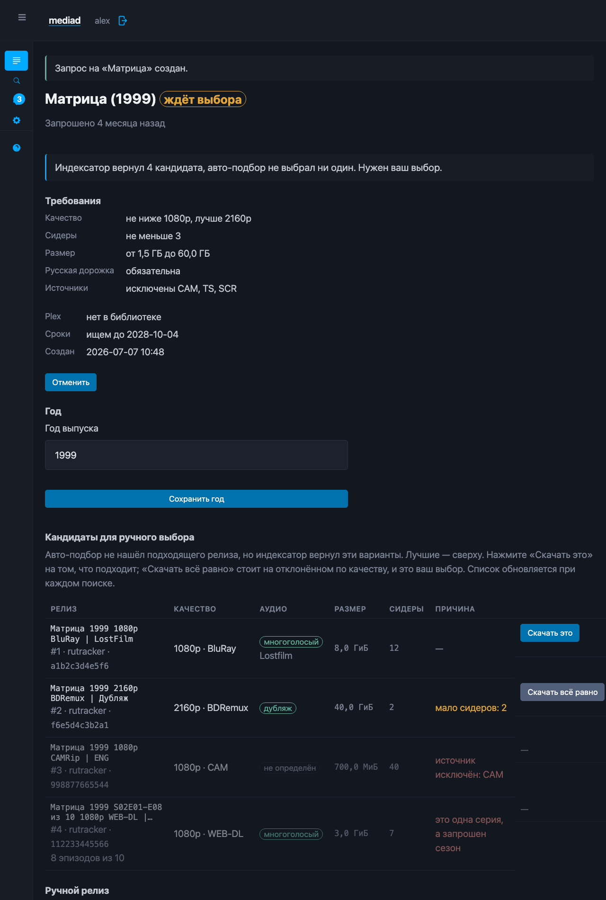
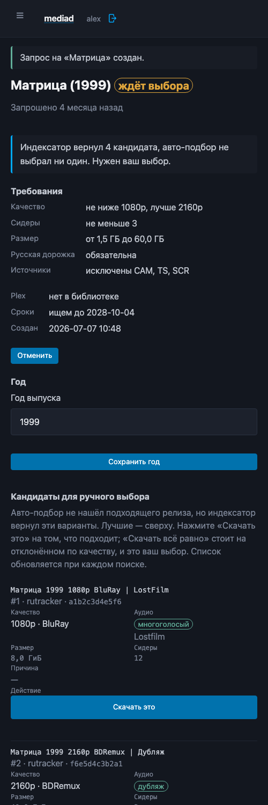
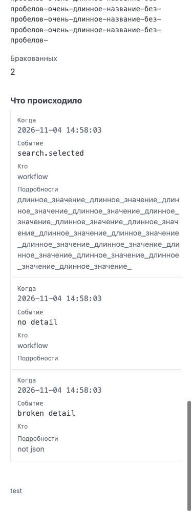
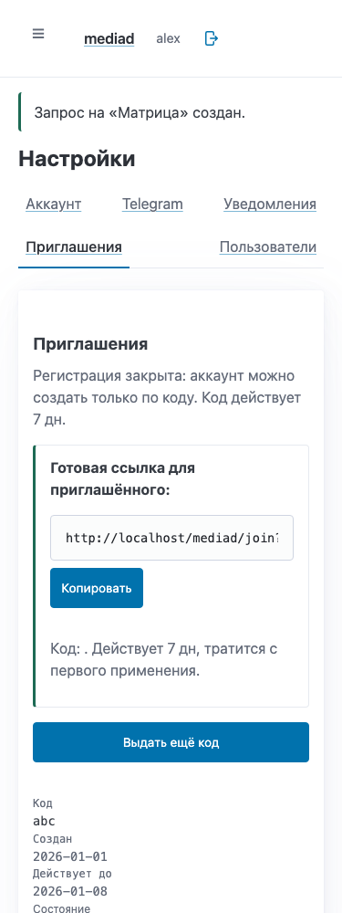

# UI patterns

One screenshot per pattern, written **after** the implementation.

The plan (`docs/ui-ux-plan.md`) is the argument for what the interface
should do; this file is the record of what it does. A pattern here is a
piece of the interface with rules of its own — a component, not a page.

---

## The candidate table

**What it is.** The releases a person chooses from when the selector
refused all of them. It is the one place in the product where somebody
decides whether the bot understood them.

`internal/web/views/request.html`, the rows built by
`internal/web/candidates.go`, the words in `internal/web/vocab.go`.

**The rule.** A row shows what the release *is* and not only why it was
refused. «Нет русской дорожки» is an answer only if the reader can see
what the release actually has.

| Column | What it carries |
|---|---|
| Релиз | the name, clamped to two lines, with the rank, the tracker and the infohash under it |
| Качество | the resolution and the source — «1080p · BluRay» |
| Аудио | the tier of the Russian audio, the studio that decided it, and the word in the name that settled it (in the tooltip) |
| Размер | the size, as a person reads one |
| Сидеры | the count — «—» when the indexer never reported it, which is not the same as zero |
| Причина | why it was refused, in Russian, with the release's own numbers («мало сидеров: 2») |
| Действие | the pick, and it follows the reason |

**Three rules the table holds to.**

1. **The action follows the reason.** A release refused on principle — a
   camrip, a blacklisted hash, a release with Russian subtitles and no
   Russian audio — has no button at all, and its row is dimmed. A release
   refused on quality gets «Скачать всё равно», which says out loud that it
   is an overrule of the policy. The endpoint asks the same question the
   row asks, so a hidden button is not a rule with no teeth.
2. **The best of the refusals is first.** The list is ordered by the
   selector's own score, so the release worth overruling the rules for is
   the one at the top, and the camrip is at the bottom.
3. **The facts are read out of the name, not stored.** The resolution, the
   source, the audio tier, the studio and the deciding marker come from
   `release.Parse` and `release.DetectAudio` — the selector's own
   functions — at render time. A stored copy would be a second copy of the
   rules, free to disagree with the first.

**The reason's numbers belong to the release.** «2 сидера» is what this
release has. The threshold it missed is the policy's, and the policy is on
the same page, in «Требования». A threshold stored with the candidate
would be a second copy of the rule, and it would go stale the moment the
rule changed.

**On a phone** the table becomes a card: the release name is the card's
heading, the quality and the audio share a line, the size and the seeders
share a line, the reason takes a line of its own, and the pick is a
full-width button a thumb can reach. One DOM either way — the stylesheet
chooses the rendering — so the data is in the page once and a screen
reader announces it once.

## Narrow tables and the event timeline (Phase 3)

All data tables retain one DOM with explicit table/row/cell/header roles and
`data-label` on cells. The existing `table-cards` layout now follows the width
of `main` through a 60 rem container query: an open sidebar and a tablet both
leave less room than the viewport suggests. On phones, event entries have a
vertical rule and their full detail wraps; machine codes remain in «Расширенное».

Headers stack the poster above the title at ≤768 px. Facts, selects and the
invitation copy row stack; state pills scroll horizontally. Controls have
44 px mobile targets, and visible focus follows both controls and wrapping
labels. Search/header pictures select `w185` at ≤767 px through the same poster
proxy, retaining the existing desktop fallback and deployment prefix.

Screenshots use rendered fixtures at 375 px. Layout checks in headless Chrome
covered 320 / 375 / 768 / 1024 / 1440 px, light/dark and both desktop sidebar
states, including deliberately long paths and event details. These checks do
not substitute for Safari/VoiceOver or a user study.
